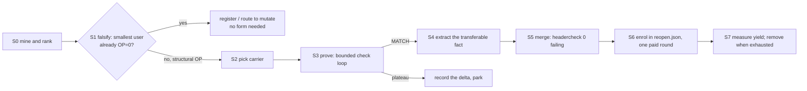

# Proving forms: the leverage loop

A matching decompilation is stuck on *spelling*, not on understanding. The remaining 8,469
functions have no source at all (`funcs.json` has 25,986 starts; `functions.json` 17,517 entries,
17,390 of them matched). What separates a match from a near-miss is usually the source form of a
helper the original inlined, not the logic.

## What a form is

A **form** is a source construct plus the exact instruction schedule armcc 4.1 b1049 emits for it,
proven byte-exact on a **carrier**:

- the carrier is one function in the game that *is* the construct (an out-of-line helper) or a
  minimal user of it;
- `fn.py check` prints `RESULT: MATCH` **and** `IDENTITY: N verified, 0 MISMATCH` for it;
- the proof object is: the header hunk (or recipe), the carrier source, its exact `cc`/`flags`,
  the marker set that finds its users, and a measured reach.

Anything short of that is a hypothesis. 45/51 words is not a form; it is a plateau, and plateaus
are input to the *next* form hypothesis (e.g. "the original ends `mov r0, r4`; armcc emits a
vptr-setter we cannot place").

Once a form is proven it does not belong to one function: it belongs to `shared/include/`, and
every unmatched function carrying its markers is *reopened* (`shared/reopen.json`) so the campaign
retries it with the form named in the prompt and without counting attempts made before the form
existed.

## Why this is the lever

Measured on the current tree:

| size (words) | functions | matched | rate |
|---|---|---|---|
| 9–16 | 4,321 | 4,096 | 95 % |
| 17–32 | 4,398 | 3,158 | 72 % |
| 33–64 | 4,318 | 1,921 | 44 % |
| 65–128 | 3,814 | 1,414 | 37 % |
| 129–256 | 1,377 | 115 | 8 % |
| 257–512 | 706 | 8 | 1 % |
| 513+ | 236 | 3 | 1 % |

Small functions match because their code is one construct. The tail is large functions made of
many constructs; every construct guessed wrong sinks the whole function. A form proof costs one
function; its reach is every user of the construct:

- 6,909 unmatched functions are ≤160 words, i.e. cheap to *check* once their constructs are right;
- the five proven forms in `shared/reopen.json` made 594 targets eligible instead of 123, and
  rounds 17–18 Haiku matched 15/60 reopened targets against 8/60 regular ones (1/30 in round 18);
- the string family alone (`sead_string.h`) is 3,058 matched entries built on one header.

Per-function search pays the construct cost again for every function. A form pays it once.

## Four kinds of form

| kind | carrier | what transfers to users | how it fails |
|---|---|---|---|
| **header type / inline form** (sead strings, list wrappers, `Vec3::setCopy`) | smallest user, or the type's out-of-line ctor/method | the spelling that produces the exact inline schedule | no out-of-line instance and no small user; or the schedule needs a different spelling per call site |
| **helper signature / layout** (an unmatched callee with many unmatched callers) | the callee itself | prototype, field offsets, vtable slots, argument registers | the callee is already matched (its layout is known; the users' deficit is complexity) |
| **symbol spelling** (`extern void func_00115C54(...)` vs `v.setAdd(...)`) | a user that calls the helper | the name the compiler must emit to reach the game address | mangled member names are masked by the byte compare and *unverifiable* by IDENTITY |
| **compiler / runtime recipe** (`__aeabi_f2lz`, memcpy dispatcher 0x0010E3C4, vptr setter) | a user whose only delta is the schedule | a recipe (spelling → bytes), not a header | the spelling space is exhausted; park it with the measured delta |

The distinction matters because only kinds 1–3 can be repaid by a header. Kind 4 is repaid by a
`shared/recipes.json` entry and an agent hint, and is usually not worth a dedicated proof.

## The loop



### S0 — mine and rank

`uv run python tools/formmine.py --rounds 3` (also printed by `harvest`) lists markers that recent
misses contain and whose users match far below the rate expected for their size. That filter is
right but its size buckets are coarse and it counts every user, so big functions dominate.

The census used for this document applies the same marker extraction to **all** starts and ranks
by *small-user reach*:

```
score(marker) = unmatched_users(marker, words <= 160) * (1 - observed_rate / expected_rate)
expected_rate = mean over users of the match rate of their log2 word bin
```

Output is cached at `logs/campaign/formcensus.json` (marker → users, matched users, sizes).
A `formmine.py --all` flag implementing this is the one tooling change this method needs.

### S1 — falsify before proving (the 30-second gate)

**The marker's reach is not evidence that the form is missing.** Take the smallest unmatched user
of the marker and compile it against the current header. One check decides:

| result | meaning | action |
|---|---|---|
| `OP=0`, `REG` small | the construct is already expressible; the delta is register allocation | `mutate.py` / `refine.py`, **not** a form |
| `OP=0` after a mutate sweep with no move | compiler-schedule recipe (kind 4) | park with the measured delta |
| `OP>0` on the marker's own construct | the form is genuinely missing | proceed to S2 |
| `MATCH` | the marker was never the blocker | register it; run `famclone`; drop the marker |

Cost: ≤5 checks per marker, ~1 s natively. Run it over every candidate before spending anything.

Worked example (0x001512B4, 52 bytes, 13 words, calls `Vec3::setAdd` 0x00115C54, 675 unmatched
users): six spellings against `vec3.h`; best is `p->v.setCopy(tmp)` at
`OP=0 REG=3 MOVED=0`, aligned 13/13, 10/13 words. The call is already right, the aggregate copy is
already in the header, and only the register choice (`ldm {r0,r1,r3}` with dest `r2` vs
`ldm {r1,r2,r3}` with dest `r0`) is left. **The Vec3 deficit is the register tail, not a missing
form.** `mutate.py --src c.cpp --budget 3000` then moved nothing (3000 checks, 9 restarts, 52 s,
`OP=0 REG=3` unchanged), so the residual is a compiler-schedule fact, not a rewrite. The matched twin
`0x001512E8` (`src/work7/gpt16/func_001512E8.cpp`) uses the same call via
`extern void func_00115C54(V*, const V&, const V&)` and a local struct with `operator=` — evidence
that the *symbol spelling* transfers, not that a new type is needed.

### S2 — pick the carrier

Rules, in order:

1. **The out-of-line instance, if unattempted.** It *is* the form: no inlining, no caller register
   pressure. 0x00115C54 is 7 words; 0x00115C70 7; 0x00115D70 6; 0x0010E3C4 (declared
   `MemUtil::copy`) 88; 0x004356B4 24.
2. **The smallest confirmed user** (S1 said `OP>0` structural) ≤64 words. Match rate there is
   44–95 %; the carrier is a test, not a deliverable.
3. Never a >160-word carrier as the first proof.

Start the source from `uv run python tools/dna.py query 0xADDR` (nearest matched twins carry a
working source) or from an existing local definition in the 17k matched corpus.

### S3 — prove, with a budget

Write the construct in `shared/include/` with the evidence address in a comment, and the carrier
under `logs/manual/FORM_<ADDR>/`. Iterate with

```
uv run python tools/fn.py check logs/manual/FORM_<ADDR>/<v>.cpp 0xADDR \
  --cc 4.1/b1049 --flags "<exact flags from functions.json or the default set>"
```

Gates:
- `RESULT: MATCH` **and** `IDENTITY ... 0 MISMATCH`; a masked branch is not proof (S4);
- honesty: no forbidden construct (AGENTS.md) — a match that needs one is a hack, recorded as such;
- budget: **≤300 checks** (~1 min at 16 jobs) or **≤2 h** of agent time per form, whichever first.
  On exhaustion record the best `OP/REG/MOVED` and the first 3 differing instructions: that is the
  next form hypothesis (this is how "copy() vs copyLocal()", "append needs the offset in a local"
  and "the original ends `mov r0, r4`" were found).

### S4 — extract the transferable fact

Before merging, answer: *what does a user get from this proof?*

- a type and its inline schedule (string tree, `setCopy`),
- a prototype/layout (field offsets, vtable slots, argument registers),
- a symbol spelling (address-named `extern`, not a mangled member),
- a flag/recipe,
- nothing (register-only) → do not merge, park.

If the answer is "nothing", the proof was still worth a match, but not worth re-planning the pool.

### S5 — merge and regress

```
uv run python tools/headercheck.py <edited.h> --jobs 16     # must be 0 failing over all adopters
uv run python tools/headermigrate.py <Type> <header.h>      # dry run, then --apply (one at a time)
uv run python tools/audit.py                                # functions.json invariants
```

`headercheck` compiles every matched source built on the header (directly or transitively). It was
688 entries / 0 failing after the round-22 string work; it is the only thing that proves a form did
not break the 3,058 entries already using the header. Never merge two headers' edits in parallel.

### S6 — enrol and measure

Add a `shared/reopen.json` entry (the planner's input):

```json
"form-id": {
  "since": "<local time of the proof, YYYY-MM-DD HH:MM>",
  "header": "<file>",
  "hint": "names the form and the spelling, in one or two sentences",
  "calls": ["0xADDR"], "words": ["0xRO"], "insn": [["0xMASK", "0xVALUE"]]
}
```

`campaign.py next` finds users by the markers, ignores attempts before `since`, and puts them first
in each tier (Haiku 100 %, DeepSeek 50 % of slots). Verify the planner actually picks them:

```
uv run python tools/campaign.py next
uv run python tools/campaign.py next --queue-only     # if the plan must not move yet
```

Then one paid round, then `uv run python tools/campaign.py harvest --commit` (registers claims,
runs `famclone`, writes the ledger) and `status` for the hit rate.

**Yield gate:** reopened functions must match at ≥2× the tier's regular rate. Rounds 17–18:
15/60 vs 8/60 (1.9×) — marginal; the round-22 forms were too fresh to judge. A form that does not
beat that after one round is either mis-marked (wrong marker set) or does not transfer; fix the
markers before proving another form of that kind. Remove the entry once its users are worked
through, or the reopened pool crowds out the regular one.

### S7 — record

One line in `docs/LESSONS.md` per form: what was proven, the rejected spellings, and the measured
delta. Plateaus are the most valuable line — they define the next form.

## Cost and yield

| item | cost | measured |
|---|---|---|
| one check, native | 0.1–0.2 s | 16 jobs safe, no gain above |
| carrier falsification (S1) | ≤5 checks | ~1 s per marker |
| proof (S3) | 60–300 checks | ~1 min CPU + agent time |
| `headercheck` after merge | 688 entries | 0 failing (round 22 report) |
| reopen round | one campaign round | ~60 targets, 15 matches (round 17–18 reopened) |

A form is worth proving when `small-user reach ≥ 20` **and** S1 says `OP>0` on its construct. A
375-user marker that fails the falsification test is worth zero header work — that was the whole
Vec3 story (675 users, but the construct was already present).

## Anti-patterns (each measured here)

- **Ranking by raw caller count.** Vec3 helpers: 1,381 callers, 12 % matched — but their users are
  large functions, and the smallest user is already `OP=0`. `MemUtil::copy` (0x0010E3C4) is
  declared in `sead_string.h` and its 344 unmatched users are mostly >160 words.
- **Clustering markers by user-set overlap.** Large functions call every helper, so one cluster
  swallows 95 markers. Cluster on small users only, or do not cluster: rank markers and dedupe by
  the S1 pilot.
- **Treating "declared" as "proven".** `Vec3::setAdd` has a declaration and an address comment in
  `vec3.h`, but no matched source calls it; the declaration is documentation, not a form.
- **Ignoring the symbol.** A member declaration emits `_ZN4Vec36setAddERKS_S1_`; the byte compare
  masks the branch, and IDENTITY only verifies names ending in an address, so a wrong call can
  pass unverifiable. Where a helper is out of line and unmatched, the address-named `extern` is the
  spelling that can be verified (`func_00115C54`), and the header must offer it.
- **Proving compiler behavior as a type.** `SafeString::comparen` (needs `ldrbeq`/`cmpeq`, best
  38/51) and the vptr setter at 0x004941D0 are not missing classes. Park them with the recipe.

## Current backlog (scratch census, 2026-11-07)

`un<160` = unmatched users ≤160 words; `rate/exp` = observed vs size-conditional expected match
rate; `inst` = the marker is itself a function start.

| marker | name | users | un<160 | rate/exp | inst | S1 verdict |
|---|---|---|---|---|---|---|
| 00115C70 | `Vec3::setSub` | 850 | 453 | 14 % / 27 % | yes (7 w) | S1 pending; run the same pilot |
| 00115C54 | `Vec3::setAdd` | 733 | 381 | 8 % / 25 % | yes (7 w) | falsified: `OP=0 REG=3` via `setCopy` |
| 00115D70 | `Vec3::setMul` | 362 | 166 | 5 % / 20 % | yes (6 w) | S1 pending; same family |
| 0058E2B8 | (matched helper) | 200 | 140 | 6 % / 28 % | yes (6 w) | helper proven, callers fail: S1 on one user |
| 0068C690 | `angleFromVec` | 333 | 192 | 12 % / 27 % | yes (65 w) | helper proven; check call shape |
| 004356B4 | (stateful 12-byte-copy helper) | 294 | 123 | 4 % / 19 % | yes (24 w) | **unproven carrier** (agent best 11/24); layout evidence only |
| 00114608 | `__aeabi_f2lz` | 196 | 102 | 3 % / 22 % | yes (25 w) | recipe, not a type |
| 0010E3C4 | `MemUtil::copy` (memcpy) | 368 | 104 | 8 % / 17 % | yes (88 w) | recipe/call site |
| 004D80A4 | (matched) | 235 | 122 | 9 % / 24 % | yes | S1 on one user |
| 00115DC8 | `Vec3::normalize` | 241 | 127 | 5 % / 21 % | yes (18 w) | S1 pending; same family |

The honest reading: the two biggest marker families are **already expressible** in the headers and
fail in the register tail. The next real form candidates are the ones where S1 still shows a
structural OP on an unproven helper — 0x004356B4 (layout: byte flag at 0x30, 12-byte fields at
+4/+0x10/+0x1c, vcall slot 4) and the call-site spellings of matched helpers whose users all fail.
Run S1 over the rest of `logs/campaign/formcensus.json` before proving anything.

## Tooling gaps

1. `formmine.py --all`: rank over every start (not only recent misses) with log2 size-conditioned
   expectation and small-user reach; emit marker → smallest user + its best source.
2. A form ledger (`shared/forms.json`): id, status, carrier, header hunk, markers, reach at proof
   time, current reach, plateau notes. `reopen.json` stays the planner's projection of it.
3. `mutate.py` should accept a `--src` carrier from S1 directly (it already does) and be the
   default route for `OP=0` falsifications, so they never re-enter the form queue.
